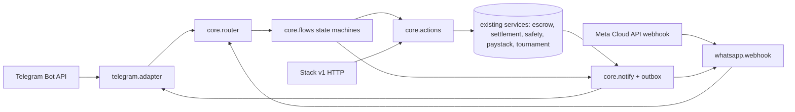

# Boardman on every chat app: channels design

Status: design proposal, 2026-10-15. Nothing here is implemented. Based on `main` at 54f1a9e.

Scope: ship the full Telegram bot experience on WhatsApp (Nigeria/Africa first), keep Telegram working the whole time, and prepare for iMessage later.

Notation: **[?]** marks a platform fact (Meta, Apple, Twilio) that comes from memory, not from current docs. Check each one against the vendor's current documentation before building on it. Code facts cite `path:line` on `main`.

---

## 0. Summary

| Question | Answer |
|---|---|
| How coupled is the bot to Telegram? | **High.** The money primitives are reusable services. The orchestration around them (who may act, which checks run in which order, DB writes, what to tell whom) lives in aiogram handlers, and the backend imports the bot to send messages. |
| Hardest flows to port | (1) Report result: photo, multi-step interview, AI vision, and the evidence stored as a **Telegram `file_id`**. (2) Spend approvals: proactive, 120 s timeout, forgeable without an ownership check. (3) Withdraw: the transaction password is typed into the chat. (4) Challenge wizard: catalogs of more than 10 games and mixed URL/callback keyboards. (5) Public challenges posted to a Telegram group. (6) Web login via the Telegram widget. |
| Identity | A new `channel_identities` table (channel, external_id, profile_id, verified_at, …) replaces `profiles.telegram_id` as the key. Accounts are linked with a one-time code issued on the signed-in channel and sent from the new one. Web login for WhatsApp users uses a "reverse OTP" (the user sends a code *to* us). |
| Template messages | About 12 utility templates cover every proactive notice (challenge received, accepted, locked, report reminder, settled, refund/expiry, deposit, withdrawal/outflow, spend approval, cup match ready, top-up credited). Marketing templates come later and are optional. |
| Architecture | `src/channels/core` (intents, a per-user flow state machine, actions, notifications, a renderer interface), plus adapters in `src/channels/{telegram,whatsapp,fake}`. Migration uses the strangler pattern, one flow at a time. |
| Biggest risk | **Meta policy.** WhatsApp Business/Commerce policies restrict real-money gambling **[?]**. Staked skill matches may be acceptable; spectator betting is the most exposed. Get written clarity before spending on Phase 1. |

---

## 1. Feature inventory of the Telegram bot

### 1.1 Runtime facts that matter for porting

- **One process does everything.** `src/bot/main.py` runs aiogram polling (webhook mode is a stub) **and** the APScheduler jobs in `src/bot/jobs/expiry.py:368`: challenge expiry, stale-lock sweep, settlement, report nudges and timeouts, wallet watch, escrow reconciliation and funding-rail watchers, every 2–10 min. If the bot stops, refunds and nudges stop too.
- **Conversation state lives in memory.** `MemoryStorage()` (`main.py:43`) holds the FSM for 5 wizards (`ChallengeWizard`, `ReportWizard`, `FiatTopupWizard`, `SendState`, `TxPassword*`). The double-tap guard `check_idempotent` (`services/safety.py:122`) and the profile cache (`utils/db.py`, keyed by `telegram_id`) are also in memory. A restart loses all wizards in flight, and two processes cannot share the state.
- **Outbound messages have one door:** `notify_user(profile_id, html, buttons: InlineKeyboardMarkup)` (`src/bot/utils/notify.py:119`). It looks up `profiles.gaming_telegram_chat_id` / `telegram_id`, sends HTML and logs failures to `notification_failures`.
- **Formatting:** handlers and services build Telegram HTML inline (`<b>`, `<code>`): about 400 occurrences across `src/bot`, plus more in `clawstation_settlement.py`, `wallet_activity.py` and `tx_approval.py`.
- **Size:** `src/bot` is about 10.8k lines. `simple_ui.py` alone is 1,958 lines and holds the button-first UX.
- `src/backend/bot/` is an older, separate aiogram bot and is out of scope here. It is kept per the scope decision but not wired into `src/bot/main.py`.

### 1.2 User flows

"Money" lists the service calls that move or reserve funds. "TG-only" lists the Telegram features each flow relies on: IK = inline keyboard and callback data, DL = `/start` deep link, PH = photo upload, ED = message edit, TX = typed secret, URL = URL button, WA = Web App, GRP = bot in a group.

| # | Flow | Entry | Steps | Backend / money | Proactive notices | TG-only |
|---|---|---|---|---|---|---|
| 1 | Onboarding | `/start [payload]` | Instant ack, optional geo check, `get_or_create_profile` (tag taken from the TG `@username`), store chat id, set the Arc chain, then the payload: `ctr_*` (partner attribution), `cup_*` (auto-join cup), `m_*` (open match → Accept) | `partners.attribute_profile`, `tournament.join_tournament` (**entry fee lock** when money is live) | none | DL, IK, username, menu-button WA, bot commands |
| 2 | Menus / info | `menu:main`, `ui:more`, `ui:community`, `ui:rules`, `menu:learn`, `ui:playbook`, `/help`, `/howto`, fallback text | Static copy, links to site/arena/leaderboard/community | none | none | IK mixed with URL buttons |
| 3 | Wallet / balance | `/balance`, `menu:wallet` | Balance snapshot (spendable, legacy, $PLAY, streak) | `clawstation_circle.get_balance_summary` | none | IK |
| 4 | Deposit: Paystack NGN | `ui:get_money` → `ui:topup:paystack` | Amount (presets or text) → `create_topup` + `paystack.initialize_transaction` (email synthesized as `tg<id>@…`) → **URL button** to pay → "I've paid" (`ui:topup:paystack:check:<ref>`) → `verify_transaction` → status `paystack_paid` → admins DMed → ops `/credit_topup` | `fiat_topup`, `paystack`; the credit is manual from the float | top-up credited (`fiat_topup.py:911`), admin alerts | IK, URL, synthetic TG email |
| 5 | Deposit: bank transfer NGN/USD | `ui:topup:ngn` / `ui:topup:usd` | Amount → quote → confirm → **upload proof photo** → admin review | `fiat_topup` | credited / rejected | IK, PH |
| 6 | Deposit: crypto / rails | `ui:topup:crypto`, `ui:topup:stellar`, `ui:topup:avalanche`, `ui:get_usdc`, `ui:topup:kobox` | Show play address, faucet (testnet), rail instructions, Kobox partner info | `circle_faucet`, `funding_rails`, watchers | deposit seen (`stellar_watcher.py:257`), deposit/outflow (`wallet_activity.py`) | IK, URL |
| 7 | Challenge (button wizard) | `ui:challenge` | Mode private/public → (private) type `@tag` → amount presets → **game category → game** (catalog: about 28 mobile, 13 iMessage/GamePigeon, 5 physical, plus console) → chain (Arc only) → confirm "Send it?" → `assert_money_ops_allowed`, `assert_can_start_or_accept`, balance check → **direct `challenges` insert in the handler** (`simple_ui.py:980`) | balance check only (stake not locked yet) | opponent: "Challenge from @x" with Accept/Decline; public: post to the TG community group | IK grids larger than 3, typed text, GRP |
| 7b | Challenge (command) | `/challenge @tag amount game` | Same as 7, separate implementation in `challenge.py:130` | same | same | command args |
| 8 | Accept / decline | `challenge:accept:<id>` / `challenge:decline:<id>` | Status update, `gaming.bets` insert | none | creator: accepted (lock now) / declined | IK |
| 9 | Lock stake | `ui:lock:<id>`, `/lock_stake <code>` | Gates → idempotency → `ensure_stake_ready` → `approve_and_create_match` (creator) or `approve_and_join_match` (opponent) | **Escrow lock on Arc** (`clawstation_escrow.py:268`, `:418`) | other player: "Challenger locked" / "Both locked" | IK (the tap itself is the consent) |
| 10 | Side / match status | `ui:side:<id>:home|away|menu`, `ui:match`, `ui:info:<id>`, `/set_side`, `/set_team`, `/match_info` | Choose HOME/AWAY, show state and next step | DB update in the handler | none | IK |
| 11 | **Report result** | `ui:report:<id>` → `ReportWizard`; `/submit_score <code> 5-3` with a photo caption or as a reply; a bare photo (`proof.py`) | Photo → in-game name → side → outcome (W/L or score) → "which name is you" → confirm (`ui:reportask:go`). **The photo is downloaded via the Bot API, sent to AI vision, and its `file_id` is saved as evidence in `screenshot_creator_url` / `screenshot_opponent_url`** (`submit_score.py:619`) | `_store_report`, `_maybe_settle` → `clawstation_settlement.settle_challenge` → **payout** | both: result banner + balance + Rematch button; dispute/conflict; $PLAY awards; cup advancement | PH, IK, typed text, file_id |
| 12 | Settlement check | `ui:settle:<id>` | Re-run settlement / show status | `settle_challenge` | as 11 | IK |
| 13 | Cancel | `ui:cancel:<id>` | Propose, then the other side confirms → refund both | `rematch_cancel.execute_cancel` (**refund**) | "Opponent proposed cancel" / "Cancelled" | IK (stateful button labels) |
| 14 | Rematch | `ui:rematch` → `ui:rematch:go:<pid>` | Up to 8 recent rivals → quick challenge → confirm | `rematch_quick.create_quick_rematch` | opponent: "Rematch?" | IK list of up to 8 |
| 15 | Public board | `ui:board`, `/board`, `/leaderboard`, `/stats` | Open challenges, leaderboard, WA/URL to site | `rematch_public` | none | WA, URL |
| 16 | Cups | `ui:cups`, `/tlist`, `t:join:<code>`, `t:status:<code>`, `/tjoin`, `/tleave`, `/tstatus`, DL `cup_*` | List, join (entry fee), status | `tournament.join_tournament` (**entry lock**), `tournament_money` | cup match ready (`tournament_matches.py:170`), cup finished payout (`clawstation_settlement.py:785`) | IK, DL |
| 17 | **Withdraw / send** | `/withdraw`, `/send`, `ui:withdraw` | Needs a tx password (`/set_tx_password`, typed in the chat) → to `0x…` or `@tag` → amount → **password typed in the chat** → gates → Circle `transfer_usdc` → audit row. Reset: `/reset_tx_password` shows a 6-digit code **in the same chat** and the user types it back | `send._execute_transfer` (**debit**) | withdrawal/outflow DM (`wallet_activity.py`) | TX, IK; messages are never deleted |
| 18 | **Spend approvals** (web-initiated) | DM from `tx_approval.start_approval` | Web bet/LP → if mode is "ask", DM with **✅ Yes / ❌ No / 🔁 Always** (`approve:<d>:<id>`), 120 s timeout → ownership check (`approvals.py:78`) → `resolve_approval` → `apply_approved_spend` → **edit the message** with the result. `/approvals` toggles ask/always per action | `rematch_web` bet/LP pull (**debit**) | the prompt itself | IK, ED, callback alerts |
| 19 | Dispute / support | `/dispute <code> <reason>`, `/support_id` | Flag the match, give a support id | DB | admins notified | command args |
| 20 | Profile | `/profile`, `/playbook`, `/link_psn`, `/link_xbox`, `/link_email`, `/set_bio` | View and edit profile | DB in the handler | none | command args |
| 21 | Ops (admin only) | `/safety /pause /unpause /paused /link_community /metrics /topups /credit_topup /reject_topup /rails_status /partners /tcreate /tstart /twinner /tcancel` | Admin console; `admin_telegram_ids()` gates it | pause switch, top-up credit, cups | admin alerts | **stays on Telegram** |

Proactive notices sent from outside a user's own action, with their sources: settlement results, disputes, no-shows and cup payouts (`backend/services/clawstation_settlement.py`); expiry and refunds, report nudges, photo nudges and abandon refunds (`bot/jobs/expiry.py`); deposits, withdrawals and unexplained outflows (`wallet_activity.py`); rail deposits (`stellar_watcher.py`); cup match ready (`tournament_matches.py`); reconciliation alerts (`escrow_reconciliation.py`); spectator bet outcomes (`stack/agentic/matches.py:103`); approvals (`tx_approval.py`).

### 1.3 Telegram-only UI features in use

| Feature | Where | Notes |
|---|---|---|
| Inline keyboards and `callback_data` | everywhere (≈60 callback prefixes) | Ids such as `ui:lock:<uuid>`; Telegram caps them at 64 bytes |
| URL buttons mixed with callback buttons | main, welcome, more, community, Paystack pay | |
| Deep links `/start <payload>` | `start.py:87`, `partners.parse_start_payload` | `ctr_`/`cup_`/`m_` |
| Photo/document upload, `file_id` reuse | report, bank-transfer proof | `file_id` only works through this bot's token |
| Message edits / callback toasts / alerts | approvals (`edit_text`), `UxCallbackMiddleware` (instant `callback.answer`, debounce) | |
| Typed "Yes" approval prompts before debits | approvals (bet/LP); challenge "Send it?"; lock button; withdrawal password | |
| Web App / login | menu button `MenuButtonWebApp` (`main.py:124`), board button `WebAppInfo`; site login via the Login Widget and WebApp `initData` (`frontend/lib/telegramAuth.ts`, `frontend/app/api/rematch/app/session/route.ts`) | |
| Group bot | `/link_community`, `utils/community.post_public_challenge` | live rooms / public challenges |
| Bot commands menu, `@username` | `set_my_commands`, tag derivation | |

---

## 2. Identity

### 2.1 Today

- `profiles.telegram_id` is **the** user key. The bot creates the row on `/start` (`utils/db.py:_get_or_create_profile_sync`). `gaming_telegram_chat_id` is the DM address and `gaming_tag` comes from the TG username.
- **Web:** the login widget or WebApp `initData`, HMAC-checked with the bot token, resolves `telegram_id → profile` (`/api/rematch/web/profile/by-telegram`). If no row exists, the site says "open the bot first". The session cookie carries `profileId` and `telegramId`.
- **Wallet:** `profiles.linked_wallet` can be set only *after* a Telegram login (`intent: 'link'`). Wallet login then resolves to that profile. A wallet cannot be the first identity.
- Telegram ids also appear in: approval ownership (`approvals.py:78`), top-up rows (`telegram_id`), the Paystack email (`tg<id>@…`), admin gating (`admin_telegram_ids`) and notification routing.

### 2.2 Proposed model

```sql
create table channel_identities (
  id              uuid primary key default gen_random_uuid(),
  profile_id      uuid not null references profiles(id),
  channel         text not null check (channel in ('telegram','whatsapp','web_wallet','email','imessage')),
  external_id     text not null,          -- TG user id | WA user id (wa_id now, BSUID later) | 0x lowercased | Apple opaque id
  address         text,                   -- where to deliver: TG chat id | E.164 phone | null
  handle          text,                   -- @username / WA profile name (display only, not unique)
  country_hint    char(2),                -- from phone calling code (WA) or TG request_contact
  verified_at     timestamptz,            -- when control of this identity was proven
  verify_method   text,                   -- 'tg_login' | 'inbound_message' | 'link_code' | 'wallet_sig'
  opted_in_at     timestamptz,            -- WhatsApp: consent to business-initiated messages
  opted_out_at    timestamptz,
  last_inbound_at timestamptz,            -- WhatsApp 24 h window; iMessage "open conversation"
  notify_priority smallint default 100,   -- lower = preferred for notices
  revoked_at      timestamptz,
  created_at      timestamptz default now(),
  unique (channel, external_id)
);
create index on channel_identities(profile_id);

create table link_codes (
  code_hash   text primary key,          -- sha256(code); never store the plain code
  profile_id  uuid not null,
  purpose     text not null,             -- 'link_channel' | 'web_login'
  issued_via  text not null,             -- channel that is already authenticated
  browser_nonce text,                    -- web_login only: binds code to one browser
  expires_at  timestamptz not null,      -- 10 min
  attempts    smallint default 0,        -- lock after 5
  consumed_at timestamptz
);
```

- **Backfill:** one `telegram` row per profile with `telegram_id`, and a `web_wallet` row per `linked_wallet`. Keep writing `profiles.telegram_id` / `gaming_telegram_chat_id` during migration (dual-write) so the legacy handlers and the frontend keep working. Remove the columns only after Phase 2.
- **Resolver:** `identity.resolve(channel, external_id) -> Principal(profile_id, channel, identity_id, country_signals, trust)`. It replaces `get_or_create_profile(user)`, and its cache is keyed by `(channel, external_id)`.
- **First contact on a new channel** creates a profile, as `/start` does today. A WhatsApp profile name is neither unique nor a handle, so onboarding asks the user to **pick a gaming tag**, or offers "Already play on Telegram? Send LINK".

### 2.3 Account linking

1. The user is signed in on channel A (Telegram, or a web session) and taps **Link WhatsApp**.
2. The server issues an 8-character code (for example `K7P-4QX`), stored hashed in `link_codes` with a 10-min TTL, and shows a `wa.me/<number>?text=LINK%20K7P-4QX` button.
3. The user sends it from WhatsApp. The webhook proves control of the `wa_id`, consumes the code, and inserts `channel_identities(whatsapp, wa_id → profile)`.
4. Confirmation goes to **both** channels: "WhatsApp +234•••1234 linked. Not you? Tap Unlink".

The same flow works in reverse (WhatsApp → Telegram via `t.me/<bot>?start=link_<code>`), and for the web (§2.5).

**Merge policy (decision needed).** If the incoming identity already has its own profile:
- **Auto-merge** only when that profile is empty: zero balance on every rail, no matches, no top-ups, no tournaments. Its identities move over and the profile is tombstoned.
- **Otherwise refuse** and send the user to support. Each profile owns its own Circle wallet and escrow history, so merging two funded profiles is a manual ops task.

### 2.4 What `wa_id` gives us, and what it does not

- **It gives:** the user's phone number in E.164 form, i.e. a calling-code **country signal** (§5). It also proves the person controls a WhatsApp account on that number, which is a strong signal; Telegram ids reveal no phone at all. We also get a display name.
- **It does not give:** real location, KYC identity or ownership history.
- **Nigeria-specific risks:** **SIM swap** fraud, and **number recycling** after long inactivity. Treat `wa_id` as a possession factor, not as identity proof.
- **Usernames:** Meta has announced WhatsApp usernames and a *business-scoped user id* that may replace the phone number in webhooks for users who adopt usernames **[?]**. So `external_id` must be whatever stable id the webhook supplies. The phone goes into `address` / `country_hint` and may be null.

### 2.5 Web login without Telegram

- **Reverse OTP (recommended).** The site shows "Send `LOGIN 4821` to Boardman on WhatsApp" with a `wa.me` prefilled link and a `browser_nonce` cookie. The webhook matches code + nonce, then the site's poll gets a session for that profile. The message is user-initiated, so it is a free service message and needs no authentication template.
- **Magic link (from inside the chat).** An "Open web" `cta_url` carries a single-use token (5-minute TTL, profile-bound, burned on first use) that `/api/rematch/app/session` exchanges for the cookie. A forwarded link expires fast. Money actions on the web still need approval (below).
- The session payload gets `channel` and `identityId`. `telegramId` stays only for the legacy admin gate.

### 2.6 Approval-prompt security by channel

| | Telegram (today) | WhatsApp (proposed) |
|---|---|---|
| Origin auth | Bot API long-poll (trusted) | `X-Hub-Signature-256` over the raw body (§4.1) |
| Who tapped | `callback.from_user.id` checked against the approval's profile (`approvals.py:78`) | `messages[].from` (wa_id) resolved to a profile, and it must own the approval |
| Replay / forward | Buttons survive forwarding (hence the ownership check) | Button id = `ap|<nonce>|<y/n/a>` with a **128-bit nonce**, not the row id. Also require `context.id` to equal the **wamid we stored** when sending that prompt |
| Staleness | edits the message | No edit: send a result message and treat any later tap on the old prompt as "already answered" |
| Expiry | 120 s poll | Same. If the user is outside the 24 h window, the prompt goes out as a **utility template** with quick-reply payloads set per send **[?]** |
| Secrets in chat | tx password typed and left in history | **Never ask for secrets in WhatsApp chat** (messages pass through Meta's Cloud API and our logs). Withdraw PIN via a web magic link or a WhatsApp Flow with endpoint encryption **[?]** |
| SIM-swap mitigation | n/a | When a number newly links to an existing funded profile: 72 h withdrawal hold, plus a notice on all other channels |

---

## 3. Coupling analysis and target architecture

### 3.1 Findings

1. **Business logic sits in handlers.** `simple_ui.ui_chal_confirm` does the gating, the balance check, builds the record, inserts into `gaming.challenges` with a schema-fallback retry, and notifies, all in one aiogram callback. Create, lock and report each exist **three times**: button UI (`simple_ui.py`), slash commands (`challenge.py`, `lock_stake.py`, `submit_score.py`) and Stack v1 HTTP (`src/stack/api_v1.py:162/338/408`). The three copies already differ: chain handling, the bets insert, side defaults.
2. **Direct DB access from handlers.** About 65 `get_supabase()` / `.table(` calls across `src/bot/handlers` and `jobs`.
3. **Inverted dependencies.** 8 backend modules import the bot: `clawstation_settlement`, `tx_approval`, `wallet_activity`, `stellar_watcher`, `escrow_reconciliation`, `tournament_matches`, `rematch_web`, `stack/agentic/matches`. They pull in `notify_user`, **aiogram keyboards** (`wallet_menu`, `approval_menu`, `rematch_after_result_menu`) and HTML copy (`utils/flow`, `zingers`).
4. **Reusable already:** `clawstation_escrow`, `safety` gates, `play_points`, `clawstation_settlement.settle_*`, `match_report` (pure analysis), `game_catalog`, `fiat_topup` + `paystack`, `tournament`, `rematch_cancel`, `rematch_quick`, `tx_approval` (apart from its notify), `partners.parse_start_payload`, `stack/facade.py`.
5. **Process coupling.** The scheduler and in-memory FSM/idempotency tie everything to one bot process.

Verdict: about 60% of handler code is orchestration that every channel would otherwise re-implement. Extract it **once**, into actions shared by the Telegram, WhatsApp and Stack v1 paths.

### 3.2 Target layout

```
src/channels/
  core/
    principal.py        Principal, CountrySignal, trust tier
    identity.py         resolve(), link codes, merge policy
    events.py           InboundEvent: Text | ButtonReply(id) | ListReply(id) | Media(ref) | Location | Referral(payload)
    messages.py         Out: Text(spans) | Choice(options) | Menu(sections) | Link(url,label) | Image | Notice(kind, params)
    capabilities.py     per-channel limits (below)
    ids.py              button-id codec: "v1|<flow>|<act>|<arg>"; ≤64 bytes; long args → server-side token
    state.py            ConversationState store (storage engine: Postgres prod / SQLite CI)
    router.py           event → intent (button id, keyword "menu"/"balance"/"help", deep-link payload, flow step)
    flows/              one state machine per flow: onboarding, wallet, deposit, challenge, accept,
                        lock, report, cancel, rematch, cups, withdraw, approvals, dispute, profile, link
    actions/            channel-free application services, called by flows, legacy TG handlers, Stack v1:
                        create_challenge, accept, decline, lock_stake, submit_report, cancel,
                        start_topup, withdraw, join_cup
    notify.py           NotificationService: notify(profile_id, Notice) → pick identity → window check →
                        session msg | template → outbox (retries, dedupe) → delivery receipts
    geo.py              channel_geo_decision() (§5)
    copy/               message catalog: key → text with semantic spans, per locale (en, pcm later)
    scheduler.py        jobs moved out of src/bot/jobs (own process / launchd job)
  telegram/
    adapter.py          aiogram Update → InboundEvent; Out → send / edit
    render.py           spans → HTML; Choice/Menu → InlineKeyboard; Link → URL button
    legacy/             today's handlers, deleted flow by flow
  whatsapp/
    webhook.py          FastAPI router at /webhooks/whatsapp (GET verify, POST signed)
    client.py           Graph API send, mark-read, media download (Cloud API; BSP-swappable interface)
    render.py           ≤3 → reply buttons; ≤10 → list; >10 → paged list / numbered text; Link → cta_url
    templates.py        Notice kind → template name, language, param order, quick-reply payloads
    media.py            download → our storage → evidence ref
  imessage/             (Phase 3, MSP adapter)
  fake/
    adapter.py          in-memory channel with selectable capability profile (tg | wa | imsg | sms)
```

**Renderer contract.** Flows never format for a channel. They emit `messages.py` objects. Each adapter declares `Capabilities`:

| Capability | Telegram | WhatsApp | iMessage (MSP) **[?]** | Fallback |
|---|---|---|---|---|
| inline buttons | ~100, any grid | 3 reply buttons (title ≤20) | quick reply ~5 | numbered text |
| list rows | n/a (use buttons) | 10 rows total, ≤10 sections (title ≤24, desc ≤72) | list picker (many) | numbered text |
| URL action | many, mixed with callbacks | 1 `cta_url` per message | rich link | plain link |
| edit sent message | yes | no **[?]** | no | send new |
| formatting | HTML | `*bold*` `_it_` `` `mono` `` | plain | plain |
| max text | 4096 | 4096 text / 1024 interactive body **[?]** | ~ | split |
| inbound media | photo/doc, `file_id` | image/doc, media id → URL valid ~5 min **[?]** | attachments | n/a |
| proactive | any time unless blocked | 24 h window, else approved template | customer-initiated only **[?]** | — |

Degrade rule for a `Choice(n)`: n ≤ max_buttons → buttons; else n ≤ max_list → list; else a paged list with "More…"; and numbered text ("Reply 1–15") as the universal fallback. The fallback also keeps SMS/USSD possible later.

**Button ids** are a versioned, channel-neutral codec. They are kept at 64 bytes or less so the same id works on Telegram. Payloads that would be longer, or that are sensitive (approval nonces), are server-side tokens. Every action **re-validates** state, because WhatsApp leaves old buttons tappable forever.

**Conversation state** is a row per `(profile_id, channel)`: `flow, step, data jsonb, version, expires_at`. It lives in the shared storage engine (`src/stack/agentic/db/engine.py`), so it survives restarts and works across webhook workers. The in-memory idempotency guard moves to the same store, keyed on `(action, ref, profile)`.



### 3.3 Migration path (strangler pattern; Telegram works at every step)

Each step is one PR with tests green, and production Telegram behaviour unchanged unless a step says otherwise.

1. **Characterization tests.** Extend `tests/test_bot_handlers.py` (it already mocks Supabase) so it covers flows 3, 7, 9, 11, 13, 17 and 18 end to end against today's handlers.
2. **Notification seam.** Add `core.notify.notify(profile_id, Notice)` backed by a Telegram-only delivery that calls today's `notify_user`. Repoint the 8 backend importers to it, and replace keyboards in backend code with semantic `Choice`s rendered by the Telegram adapter. *This removes the backend → aiogram dependency.*
3. **Identity.** Add `channel_identities` with backfill and dual-write; `get_or_create_profile` delegates to `identity.resolve`. No UX change.
4. **Scheduler out of the bot.** Move `jobs/expiry.py` to `core/scheduler.py` and run it as its own process; the bot keeps a flag to run it in-process for local dev.
5. **Actions extraction, one flow at a time.** For each of wallet, deposit, challenge, accept/decline, lock, report, cancel, rematch, cups, withdraw, approvals: (a) move logic into `core/actions`, (b) have the legacy TG handler **and** Stack v1 call it, (c) port the flow to a `core/flows` state machine, (d) route that flow's callback prefixes to the new Telegram adapter **behind a flag** (`CHANNELS_CORE_FLOWS=wallet,lock,…`), (e) after a week clean in production, delete the legacy handler. Order: wallet → approvals → lock → accept/decline → challenge → deposit → report → withdraw → cancel/rematch → cups → profile/dispute.
6. **WhatsApp adapter.** Flows ported in step 5 light up on WhatsApp automatically once its renderer exists; Phase 1 ships the money subset.

Callback prefixes stay registered in aiogram the whole time. The flag only chooses which code handles them, so rollback is a config change.

---

## 4. WhatsApp specifics (Meta WhatsApp Business Cloud API)

### 4.1 Webhook

- **Verification (GET):** Meta calls `?hub.mode=subscribe&hub.verify_token=<ours>&hub.challenge=<n>`. Echo `hub.challenge` with 200 when the token matches.
- **Signature (POST):** `X-Hub-Signature-256: sha256=<hex HMAC-SHA256(app_secret, raw_body)>`. Verify against the **raw bytes** before JSON parsing, and compare in constant time. The same pattern as `verify_circle_signature` in `src/backend/api/webhooks.py`.
- **Delivery:** at least once, no ordering guarantee, retried with backoff for hours to days **[?]**. Ack 200 fast (<1 s). Enqueue to the inbound table, then process asynchronously. Dedupe on `messages[].id` (wamid). Ignore `statuses[]` except to update the outbox (sent, delivered, read, failed and its error codes).
- **Mount at `/webhooks/whatsapp`.** `/webhooks/` is already an exempt prefix in `config/compliance/geo_fence.json`. That matters: Meta's servers are mostly US-based, and **US is on the blocked list**, so a non-exempt path would 451 every webhook. Production today is the Mac behind the cloudflared tunnel to uvicorn :8000, so the webhook rides that tunnel. Uptime directly affects the bot. See the hosting note in §8.

### 4.2 Interactive messages vs Telegram keyboards

| Telegram pattern | WhatsApp equivalent | Notes |
|---|---|---|
| IK with ≤3 callback buttons (Accept/Decline, Yes/No/Always, HOME/AWAY, Lock/Status/Menu) | `interactive.button`: ≤3 reply buttons; id ≤256 chars, title ≤20 chars **[?]** | Titles must shrink ("🔐 Lock my stake" fits; "✅ Confirm cancel (refund both)" does not) |
| IK grid of 4–10 (main menu has 9 entries, stake presets, game categories, rivals ≤8, top-up methods) | `interactive.list`: one "Choose" button opening ≤10 rows **[?]** | Main menu → list with 7–9 rows, links moved to text |
| IK with more than 10 options (games per category, open-cups list, public board) | Paged list ("More…" row) or numbered text; **WhatsApp Flow** with a dropdown for the challenge form **[?]** | Rule: category, then game; keep each page at 9 games plus "More" |
| URL button(s) | `interactive.cta_url`, **one** per message **[?]**; otherwise plain links in text (auto-preview) | Paystack "Pay" → `cta_url`; site/arena/leaderboard → text links |
| Mixed URL + callback keyboard | Split into list/buttons **plus** a separate `cta_url` or a text link | |
| `callback_data` | `button_reply.id` / `list_reply.id` | Same codec (§3.2) |
| `/start <payload>` deep links | `https://wa.me/<number>?text=<prefill>` (e.g. `JOIN M-7KQ2`, `CUP ABC123`, `CTR IKEJA01`); click-to-WhatsApp ads deliver a `referral` object **[?]** | The prefill is editable, so parse leniently; never put secrets in it |
| Photo upload | `image` or `document` message with a media id | §4.4 |
| `edit_text` / callback toasts / alerts | Not available **[?]**; send a new message, optionally react ⏳/✅ to the user's message, mark read, typing indicator **[?]** | Flows must tolerate stale taps |
| Slash commands, bot command menu | Keywords (`menu`, `balance`, `help`, `stop`); Conversational Components: ice breakers and commands **[?]** | `STOP` must opt out of notices |
| Web App menu button / login widget | `cta_url` magic link; reverse OTP for the site (§2.5) | |
| Bot posts in a community group | No general bot-in-group support for our use **[?]**. Use a **share** link (`https://wa.me/?text=…` with the match link) so users post into their own groups and Status, plus the public board. A WhatsApp Channel can be the broadcast feed (posted manually) | Arguably better virality in NG |
| Typing an `@tag` | Same (text), **plus** "challenge by phone contact" (user shares a contact card → we look up the linked profile) | Only notify opted-in users; otherwise generate an invite share link |

**Flows that need redesign, not just re-rendering:**
- **Report result:** store media in our own storage (§4.4); ask one question per message (no edits); and say the confirm summary as plain text plus 3 buttons (Confirm / Fix / Cancel).
- **Challenge wizard:** list-based, or one WhatsApp Flow form (opponent, stake, game, visibility) **[?]**. A friend not yet on Boardman gets an **invite share link** instead of a DM, because WhatsApp forbids messaging users who have not opted in.
- **Withdraw:** no typed passwords (§2.6). Confirm via a web magic link with PIN entry, or a Flow.
- **Public challenges:** share link plus board instead of the group post.
- **Approvals:** template fallback outside 24 h, with the nonce + context checks.
- **Paystack:** use the profile's verified email when present, otherwise synthesize `wa<hash>@…`. Never put the phone number in the email.

### 4.3 24-hour window and templates

Any inbound user message opens a 24 h **customer-service window** **[?]**. Inside it we can send any free-form or interactive message, and those service messages are free **[?]**. Outside it, only **pre-approved templates**. Business-initiated messages also need recorded **opt-in** (capture it on first inbound with clear copy, or at web/Telegram link time).

`core.notify` decides per send: `last_inbound_at > now − 23h` → session message; else → template (kind → template). It records the outbound wamid and status.

| Template (utility unless noted) | Trigger (source) | Quick replies |
|---|---|---|
| `challenge_received` | flows 7/14 | Accept · Decline |
| `challenge_answered` | flow 8 | My match |
| `stake_locked` (one variant for opponent-locked, one for both-locked) | flow 9 | Lock my stake / Report result |
| `report_reminder` (opponent reported; photo nudge) | `expiry.nudge_and_timeout_reports` | Report result |
| `match_result` (won/lost/draw, amount, balance) | `clawstation_settlement` | Rematch · Wallet |
| `match_disputed` (conflict / under review) | `clawstation_settlement` | Match status |
| `match_refunded` (expired, cancelled, abandoned, no-show) | `expiry`, `rematch_cancel`, `settle_no_show` | Wallet |
| `deposit_received` (wallet inflow, rail seen, top-up credited) | `wallet_activity`, `stellar_watcher`, `fiat_topup` | Wallet |
| `withdrawal_update` / `security_outflow` | `wallet_activity` | Wallet · Not me |
| `spend_approval` (bet / LP, amount, 2 min) | `tx_approval` | Yes · No · Always |
| `cup_match_ready` / `cup_result` | `tournament_matches`, settlement | My match |
| `account_linked` (security notice) | identity link | Unlink |
| *marketing (optional, later)*: rematch nudges, cup announcements, re-engagement | campaigns | — |

Rules:
- Keep utility templates free of promotion (no zingers, emoji banter or "play again!" upsell). Meta recategorizes templates that read as marketing **[?]**.
- Templates are approved per language. Start with English and add Nigerian Pidgin later.
- Agent-arena spectator outcomes (`stack/agentic/matches.py`) count as **marketing-adjacent** unless the user holds a bet. Send them only inside the window, or as a utility `bet_settled` when a bet exists.
- The authentication category is not needed if web login uses reverse OTP.

### 4.4 Media (score screenshots)

The inbound `image` / `document` message carries a media id. `GET /{media-id}` returns a short-lived URL (≈5 min) **[?]**, which we download with the bearer token. Images are capped around 5 MB and documents are larger **[?]**. Meta keeps inbound media only for a limited time (≈30 days) **[?]**.

**Decision:** on receipt, copy the bytes to our own storage (Supabase Storage bucket `match-evidence`, private) and save `evidence://<bucket>/<key>` in `screenshot_*_url`. Do the same for Telegram going forward (today it stores a raw `file_id` that only this bot token can read). `match_report` only checks truthiness, so the column format can change safely. Vision reads from our storage; disputes and the admin console read from signed URLs. Strip EXIF and cap the size before storing.

### 4.5 Rate limits **[?]**

- **Throughput:** about 80 messages/s per number by default, raised automatically for high-quality numbers.
- **Pair rate:** roughly 1 message per ~6 s to the same user, with small bursts. A burst gets error 131056, so `core.notify` coalesces (a settlement plus a $PLAY award plus a balance line become one message).
- **Messaging limits (business-initiated, unique users per rolling 24 h):** tiers from about 250 for unverified businesses up to 1K → 10K → 100K → unlimited, driven by verification, volume and quality rating. Meta has been moving these to the business-portfolio level.
- **Quality rating:** blocks and reports lower it and shrink the limits. Marketing templates can be paused.
- **Graph API:** app-level rate limits apply to media and management calls.

### 4.6 Number, display name, verification **[?]**

- Meta **Business Portfolio**, then a **WhatsApp Business Account**, then a phone number. The number must not be active in the consumer or Business app; it gets an SMS/voice OTP and a 2-step PIN.
- Recommend a dedicated **+234** number for trust and local recognition.
- **Display name** "Boardman" is reviewed against the website/brand (boardman.playingsidequest.fun must show the name).
- **Business verification** uses legal documents (for a Nigerian entity: CAC registration), a domain and an address. It is needed to leave the lowest messaging tier and to apply for a verified badge (Meta Verified for Business).
- Plan 1–4 weeks of calendar time, in parallel with Phase 0.
- **Policy review:** confirm that staked skill matches (and, separately, spectator betting) are permitted under the WhatsApp Business and Commerce policies for NG. Without that, the number risks being banned.

### 4.7 Pricing (Nigeria) **[?]**

- Since mid-2025 Meta charges **per delivered template message**, by category and country:
  - **Service** (free-form replies inside the window): free.
  - **Utility templates:** free when sent inside an open window; charged outside it.
  - **Marketing:** always charged and the most expensive.
  - **Authentication:** charged.
- Nigeria's rates are among the lower ones. Order of magnitude: marketing a few US cents, utility and authentication under one cent. Volume tiers lower utility and authentication further.
- **Check Meta's current rate card before budgeting.**
- Cost driver: utility templates for notices to users who have not messaged in 24 h. Rough budget: (active matches/day × ~3 notices × share outside the window) × the utility rate.

### 4.8 Twilio vs direct Cloud API

| | Direct Cloud API | Twilio (BSP) |
|---|---|---|
| Cost | Meta fees only | Meta fees plus a Twilio per-message fee (both directions) **[?]** |
| Features | First access to interactive, Flows, typing, usernames | Content API covers quick-reply, list-picker, CTA, cards; newer features lag **[?]** |
| Onboarding | Embedded signup ourselves; Meta support is thin | Guided sender registration; Twilio support |
| Extras | — | SMS fallback for OTP/alerts in NG (costly, DND rules), RCS later, one vendor |
| Webhook security | `X-Hub-Signature-256` | `X-Twilio-Signature` |
| Lock-in | Low (Graph API) | Medium (Twilio content SIDs) |

**Recommendation:** use the direct Cloud API behind the `whatsapp/client.py` interface. Re-evaluate a BSP (Twilio, or cheaper 360dialog) only if Meta onboarding stalls or SMS fallback becomes a requirement.

---

## 5. Geo-fence and compliance

**Today:**
- HTTP money routes go through `evaluate_request` (`middleware/geo_fence.py:486`). The country comes from edge headers or MaxMind, or for the BFF, the trusted `x-boardman-client-country`. Strict mode fails closed on unknown country.
- **Bot money operations do not go through HTTP**, so no per-user geo check runs. `start.py` only reads a *global* env var, `TELEGRAM_USER_COUNTRY`.
- `spectator_policy.request_country()` is `None` in the bot, so mainnet spectator betting from the bot is refused (KYC plan §6).

**New signal:** the WhatsApp phone number gives a calling-code country (`phonenumbers.region_code_for_number`; NANP `+1` and `+7` need the full number to resolve). It describes where the SIM is registered, not where the user is.

**Proposal:**

- `core/geo.py: channel_geo_decision(principal, money_kind) -> GeoDecision`. It reuses `_load_blocked_regions`, `blocked_list_loaded`, `strict_mode` and the `GeoDecision` type, so one blocked list (`config/blocked_regions.json`) governs every channel.
- The inputs are all `CountrySignal`s on the principal, each tagged `phone_cc`, `ip` (web), `kyc` (T1+) or `tg_contact` (optional Telegram `request_contact`).
  - **Deny if any known signal is blocked.** For example, a `+44` or `+1 (US)` number is blocked even when browsing from Lagos. This matters: US and GB are blocked, so diaspora numbers are out.
  - **In strict mode,** a money op needs at least one signal whose source is approved for money in the policy.
- **Extend `geo_fence.json`:**
  ```json
  "channel_signals": {
    "whatsapp": {"source": "phone_cc", "money_ok": true,  "spectator_ok": false},
    "telegram": {"source": "none",     "money_ok": false, "spectator_ok": false},
    "web":      {"source": "ip",       "money_ok": true,  "spectator_ok": true}
  }
  ```
  The `money_ok` and `spectator_ok` values for `phone_cc` are **counsel's decision** (`[COUNSEL]`). Until counsel signs off, spectator betting on WhatsApp links out to the web, where the IP check applies.
- **Spectator policy unchanged.** The channel request context calls `spectator_policy.set_request_country(country)` with the decided country and its source, so `assert_spectator_betting_allowed` works as is. Refusal logs gain `country_source`.
- **Linked identities lift Telegram.** A Telegram profile that links WhatsApp gains a `phone_cc` signal at the profile level. Option: on mainnet, require a linked WhatsApp number (or Telegram `request_contact`) before Telegram money ops. Founder and counsel decide.
- **KYC hooks.** Phone country ≠ KYC country, or ≠ frequent IP country, raises the "Geo mismatch" flag from the KYC plan. Re-linking a different country's number is a risk event.
- **Optional stronger signal.** WhatsApp `location_request_message` asks the user to share GPS **[?]**. Spoofable, but useful as an attestation before a first withdrawal.

---

## 6. iMessage ("eventually")

**Facts [?]:**
- **Apple Messages for Business** needs an Apple Business Register account, brand and use-case review, and an **approved Messaging Service Provider** (enterprise CX platforms).
- Conversations are **customer-initiated** only: entry points are links/buttons on our site or app, Maps and Search. A business cannot cold-message, so most of our proactive notices (results, approvals, nudges) would need another channel.
- **Gambling or real-money gaming may be rejected** in review.
- Rich features: list picker, time picker, rich links, authentication (OAuth), forms, custom iMessage app extensions. Apple Pay is irrelevant to USDC settlement.

**Consumer bridges are a no.** BlueBubbles or AppleScript on a Mac with an Apple ID violate Apple's terms, get banned, have no business identity and would sit on the same 8 GB Mac as production.

**Market fit is weak.** iPhone share in Nigeria is low. iOS-heavy markets (US, GB, JP, AU) are all on our blocked list. The existing `config/games/imessage.yaml` covers GamePigeon *games*; players of those already report through Telegram, and later WhatsApp. That is a game category, not a channel need.

**Recommendation:**
- Do **not** build iMessage until a non-blocked, iOS-heavy market is a priority **and** an MSP with Apple's approval for our category is lined up.
- Serve iPhone users with the web app (PWA, web push) plus WhatsApp or Telegram.
- If Android rich messaging is ever needed, evaluate **RCS Business Messaging** first. It reaches more users in Africa than iMessage, but carrier support in NG is unknown **[?]**.

**What the abstraction must anticipate** (all cheap now):
- A `proactive: 'customer_initiated_only'` capability, so `notify` falls back to another linked identity.
- `Menu` able to map to a list picker with images and multi-select.
- A `DatePick` message (time picker), useful for scheduling matches and cups.
- `Link` with a title and image (rich link).
- An `Auth` step (OAuth handoff) as a link-code alternative.
- Sessions with no phone number (an opaque Apple id).

---

## 7. Phased plan

Effort is in engineer-weeks (ew) for one senior engineer with AI assistance. Calendar items run in parallel.

| Phase | Content | Effort | Calendar / gates |
|---|---|---|---|
| **0. Identity and core** | Characterization tests; `core.notify` seam, with backend → aiogram imports removed; `channel_identities` + backfill + dual-write + linking codes; scheduler out of the bot; conversation-state and idempotency store; renderer + capabilities + id codec; fake adapter; Telegram adapter; first flows ported behind flags (wallet, approvals, lock, accept/decline); evidence-to-storage for Telegram photos | **5–6 ew** | No user-visible change. **Start Meta business verification, number and display name, and the policy question now** |
| **1. WhatsApp MVP (money core)** | Webhook (verify, signature, dedupe, queue); client and media; WA renderer; opt-in + `STOP`; onboarding with tag pick + **LINK**; flows: **balance**, **deposit** (Paystack `cta_url` + "I've paid"), **challenge a friend** (tag or invite share link), **accept/decline**, **lock stake**, **report result** (photo → storage → AI), **withdraw** (web magic-link PIN), **spectator bet** (link to the web + WA approval prompt; native only after counsel); ~12 utility templates; window-aware notify; reverse-OTP web login; geo signal wiring | **7–8 ew** | Gates: Meta verification, template approval (days per template **[?]**), counsel on `phone_cc` for money. Closed beta of 50 users, then partner centres (`ctr_` codes via `wa.me` QR) |
| **2. Parity** | Remaining flows ported and legacy handlers deleted: cups (+ DL), rematch, cancel, side, public board + share links, dispute/support, profile links, approvals settings, bank-transfer proof upload, Stellar/Avalanche rails, $PLAY/playbook; Pidgin copy; optional marketing templates and notification preferences; drop the `profiles.telegram_id` dependency in the frontend | **4–5 ew** | Ops/admin console stays Telegram-only (decision) |
| **3. iMessage** | Only if the §6 conditions hold: MSP selection + Apple registration; adapter; customer-initiated fallbacks | **4–6 ew** + 1–3 months of Apple/MSP calendar **[?]** | Market and policy gate |

### Test strategy

- **Fake channel adapter.** `channels/fake` runs any flow in-process with a capability profile (`tg`, `wa`, `imsg`, `sms`). It records every outbound message and lets a test "tap" by button id or "type" text. A **parametrized suite** runs every flow under every profile. It asserts the same money outcomes (escrow calls, ledger rows, notices) and that renderers never exceed limits: no more than 3 buttons on WA, 10 list rows, title lengths, one `cta_url`, and no HTML on WA.
- **Stale-tap tests:** replay an old button id after state changes and assert no double debit. **Restart tests:** persist the state, rebuild the process, continue the wizard.
- **Contract tests for the WhatsApp webhook:** recorded Meta payload fixtures (text, button_reply, list_reply, image, status, referral), signature good/bad/missing, duplicate wamid, out-of-order delivery. No network: the Graph client is a fake that captures requests and serves media bytes from fixtures.
- **Identity tests:** link-code expiry and attempts, merge refusal for funded profiles, approval ownership across channels, the context-id check.
- **Geo tests:** phone_cc blocked/allowed/unknown × strict on/off × spectator on testnet/mainnet. Reuse the cases in `tests/test_geo_fence*`.
- **Notify tests:** inside window → session message; outside → the correct template and params; opt-out → none; pair-rate coalescing.
- **Telegram regression:** the characterization tests from step 1 stay green at every migration PR.
- Cross-process tests use `spawn`, not `fork` (a known deadlock in this repo).

---

## 8. Decisions needed from the founder

1. **Meta policy exposure.** Launch WhatsApp with staked skill matches only, and keep spectator betting on the web (approval prompts are fine) until Meta and counsel clear it? *Recommended: yes.*
2. **Direct Cloud API vs Twilio/BSP.** *Recommended: direct.*
3. **Who owns the Meta Business Portfolio**, which legal entity is verified (CAC docs), and which **+234 number** and display name to use.
4. **Phone country as a geo signal for money ops** (`money_ok` for `phone_cc`). Also whether Telegram mainnet money ops require a linked phone. *Counsel input needed.*
5. **Withdraw authentication on WhatsApp:** web magic-link PIN (recommended for Phase 1) or a WhatsApp Flow. Also: retire the typed-in-chat password on Telegram too?
6. **Account merge policy:** auto-merge only empty profiles; funded merges go to manual support.
7. **Notification budget:** utility-template spend cap per month, and whether marketing templates are used at all.
8. **iMessage:** defer until a non-blocked, iOS-heavy market is a priority. *Recommended.*
9. **Admin/ops console stays on Telegram.** *Recommended.*
10. **Hosting:** the webhook and scheduler need reliable uptime. The current Mac and tunnel setup stalls about 1 request in 12. Moving to the planned always-on VM is a prerequisite for Phase 1, not a nice-to-have.
